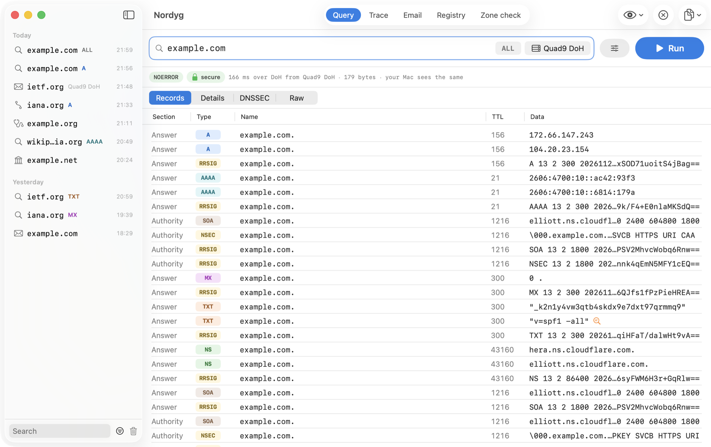

# Nordyg - A DNS client for macOS

<picture>
  <source media="(prefers-color-scheme: dark)" srcset="landing/public/screens/query-dark.png">
  
</picture>

## What it does

- **Query** any record type from any resolver, over UDP, TCP, DNS over TLS, DNS over HTTPS or DNS over QUIC, one
  resolver or several side by side. DNSSEC is validated on your Mac, from the root down.
- **Trace** a name from the root servers to the server that holds the answer.
- **Email**: MX, SPF, DKIM, DMARC, MTA-STS, DANE, BIMI and blocklists, each with a verdict.
- **Registry**: who registered a domain and when it expires, via RDAP or WHOIS.
- **Zone check**: delegation, nameservers, SOA, glue, DNSSEC, CAA and the website's certificate.
- **Watch** a query and get a notification when the answer changes.

No account and no telemetry. The [privacy page](https://nordyg.com/privacy/) lists every server the app talks to.

## Install

Download `Nordyg-<version>.dmg` from [Releases](https://github.com/n0rdy/nordyg/releases/latest), open it and drag
Nordyg to Applications. Or with Homebrew:

```bash
brew install --cask n0rdy/n0rdy/nordyg
```

Nordyg updates itself after that. It needs macOS 14 or later, on Intel or Apple silicon.

### Verifying a download

Release DMGs are signed with a Developer ID certificate, notarized by Apple, and carry a signed build attestation:
proof that the file was built by this repository's release workflow from the tagged commit, not uploaded by hand. Check
one with the [GitHub CLI](https://cli.github.com/):

```bash
gh attestation verify Nordyg-0.0.1.dmg --repo n0rdy/nordyg
```

### From source

Requires Xcode and Go. The Go version is pinned in the Makefile. Any Go on PATH that can download toolchains will do.

```sh
make test      # Go tests, no network needed
make archive   # core/build/libnordyg.a (x86_64 + arm64) and header
make smoke     # build and run the Swift bridge harness
make run       # build the app and open it
```

Or open `app/Nordyg.xcodeproj` in Xcode after `make archive`.

## Layout

- `core/` Go module with all DNS logic, compiled to a universal static C archive. The C surface is three functions (`NordygQuery`, `NordygCancel`, `NordygFree`) - everything else is a JSON contract.
- `app/` SwiftUI shell. 
- ]`app/NordygCore` is the Clang module that imports the archive.
- `app/smoke` is a Swift harness that exercises the bridge in CI.
- `landing/` the website, nordyg.com.

## Open-source but closed-contribution

Nordyg is open-source, but I do not accept external contributions. This is a personal project, and I want to keep full
control over the codebase and direction of the project. Also, I don't feel I have enough free time to review and manage
contributions (if any).

Therefore, please do not open PRs:

- If you find any bugs - please, use the `Issues` section.
- If you have questions or suggestions, use the `Discussions` section for that.

Transparency on what to expect:

- Built for my own use first. The roadmap follows what I need. Ideas are welcome in Discussions, but I may say no.
- Close to feature-complete for my needs. From here, expect bug fixes and dependency updates rather than a growing feature list.
- Still 0.x: things can change between versions.
- Help is best effort, in my spare time.

## License

GNU Affero General Public License v3.0, see `LICENSE`.
